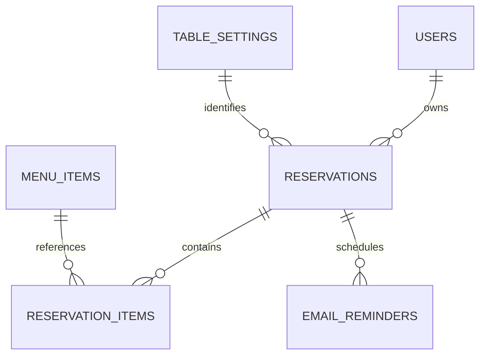

# Связи текущей модели данных

Связи users и table_settings с reservations логические: исходная SQLite-схема не объявляет для них FOREIGN KEY. Связь reservation_items объявлена в DDL. Наличие DDL само по себе не доказывает включение PRAGMA foreign_keys на каждом соединении. admin_logs хранит административные события. Полный перечень полей — data-structure.md.
